# Spidi Race 🏁


Ein Arcade-Rennspiel im Browser im Geist von 90er-Jahren Arcade Racing Games: Alpenpässe, Küstenstrassen, Stadtkurs, Superspeedway, Offroad-Pisten mit Sprüngen und ein Frühstückstisch im Micro-Machines-Stil, Splitscreen am selben Rechner und Rennen im Heimnetz. Dazu kommt eine offene Übungsstadt, in der Kinder ohne Rennstress das Fahren mit Tastatur oder Gamepad lernen. Gerendert wird mit Three.js, Modelle und Texturen stammen aus CC0-Paketen von Kenney und ambientCG.

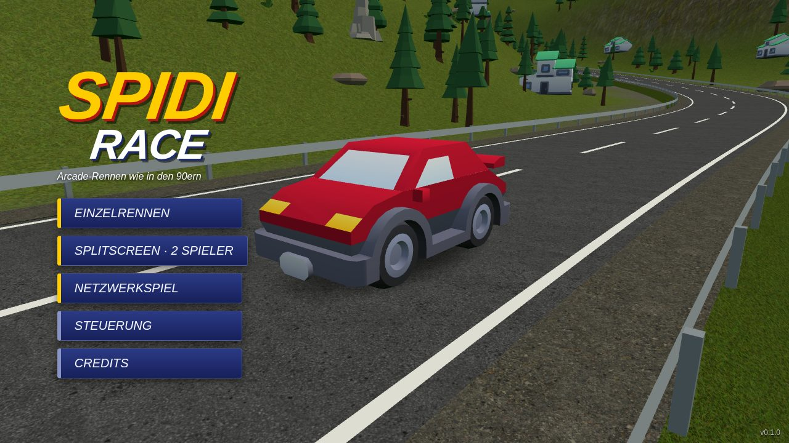

| Küstenstrasse | Downtown |
|---|---|
| 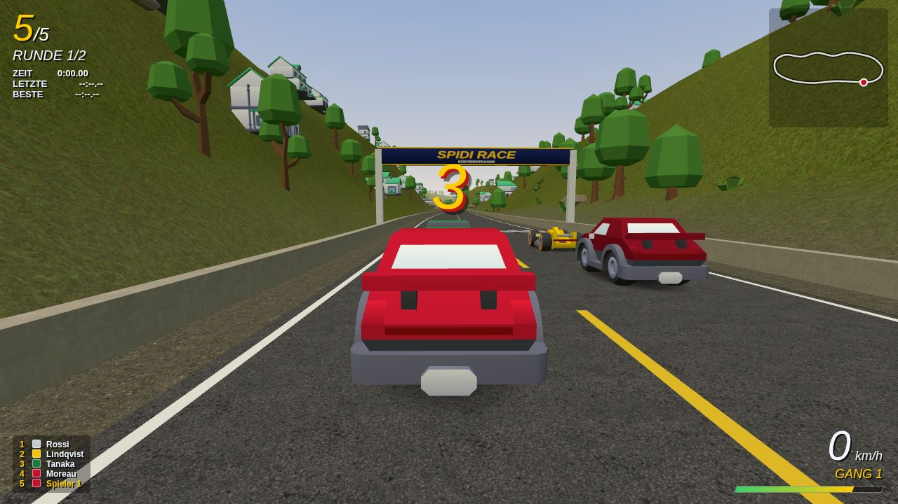 | 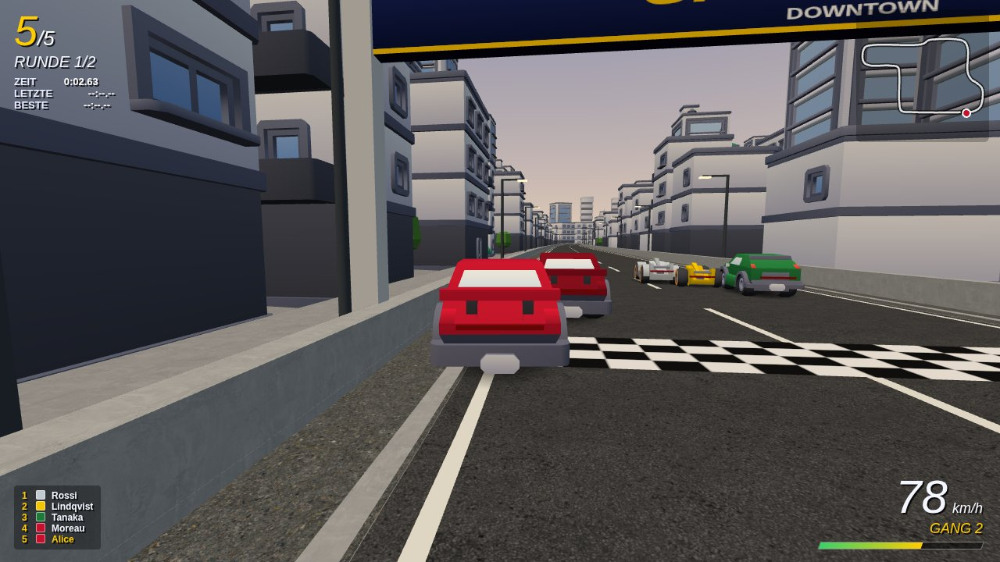 |
| **Speedway** | **Splitscreen** |
| 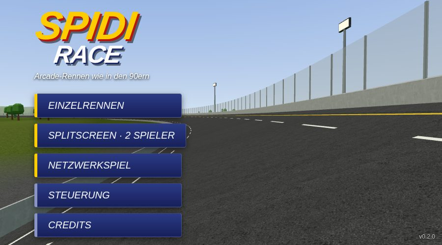 | 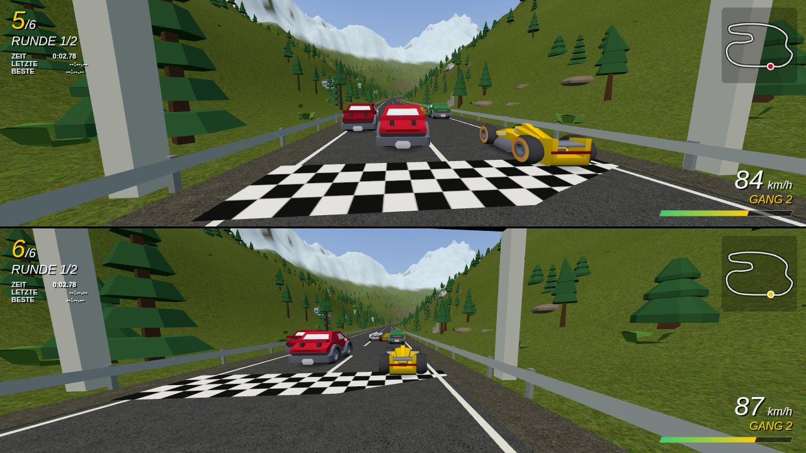 |
| **Canyon Run (Offroad)** | **Waldtrail (Offroad)** |
| 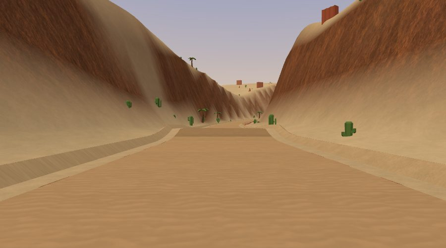 | 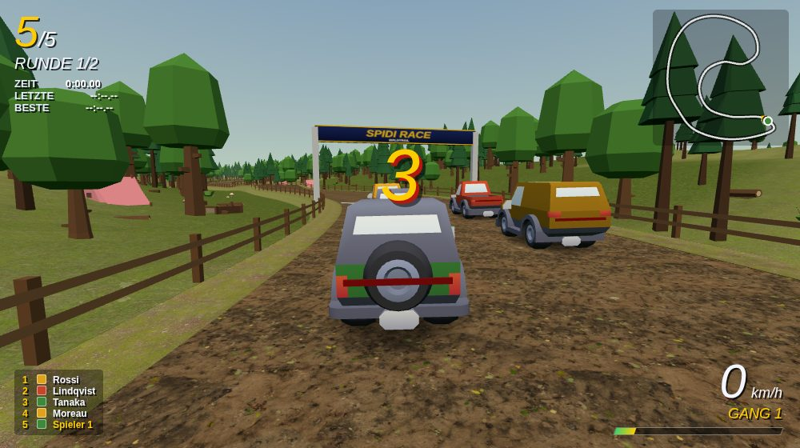 |
| **Frühstückstisch (Micro)** | **Übungsfahrt in der Stadt** |
| 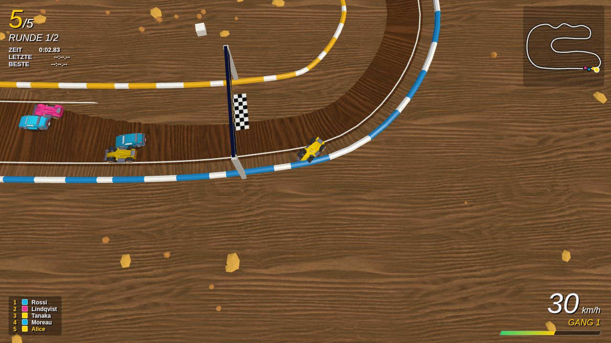 | 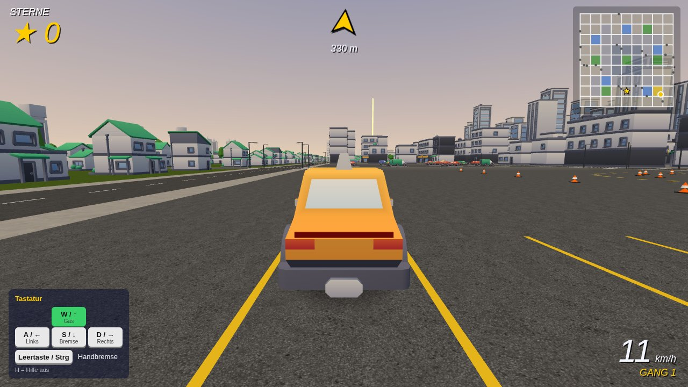 |
| **Kart-Rennen mit Items** | **Kart-Battle in der Stadt** |
| 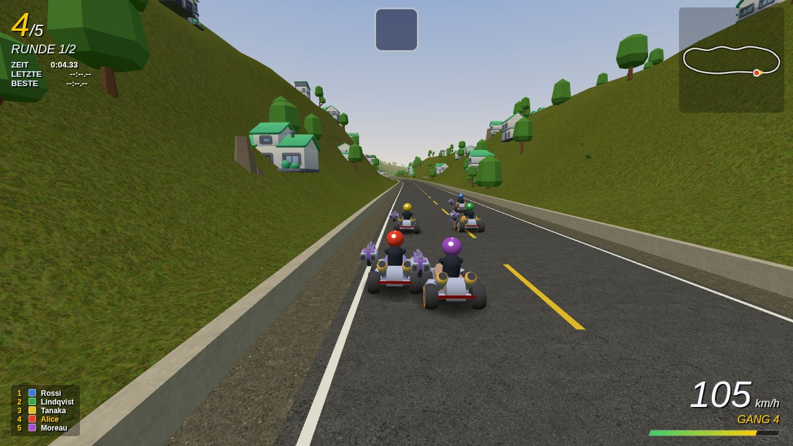 | 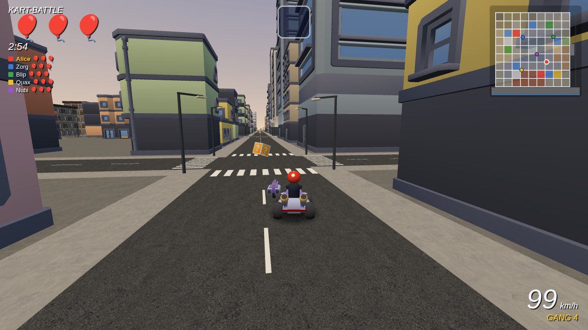 |
| **Flughafen (Autorennen)** | **Flughafen Kart** |
| 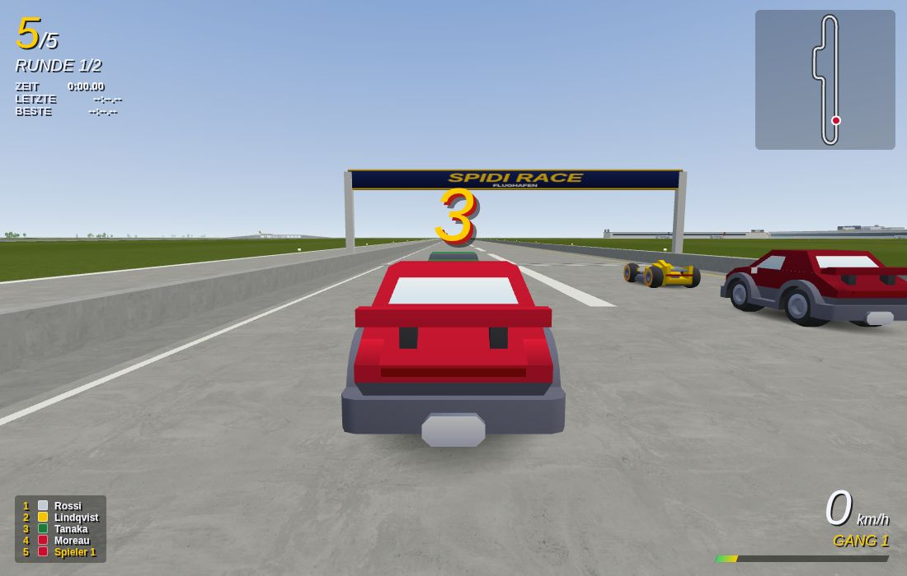 | 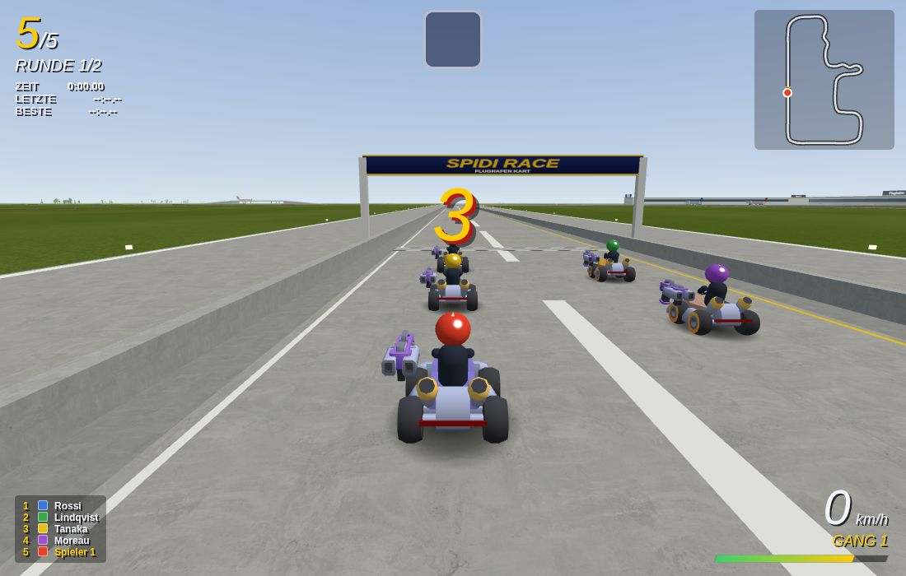 |

## Inhalt

- [Features](#features)
- [Schnellstart mit Docker](#schnellstart-mit-docker)
- [Steuerung](#steuerung)
- [Kart-Rennen mit Items](#kart-rennen-mit-items)
- [Übungsfahrt in der Stadt](#übungsfahrt-in-der-stadt)
- [Netzwerkspiel](#netzwerkspiel)
- [Rangliste](#rangliste)
- [Entwicklung](#entwicklung)
- [Grafik-Assets](#grafik-assets)
- [Architektur](#architektur)
- [Versionierung](#versionierung)
- [Lizenz und Credits](#lizenz-und-credits)

## Features

- **9 Strecken** in drei Klassen

  | Strecke | Klasse | Modus | Länge | Charakter |
  |---|---|---|---|---|
  | Alpenpass | Strasse | Auto + Kart | 2,5 km | Serpentinen, Lawinengalerie, Schneeberge, bunte Chalets und Fachwerkdorf |
  | Küstenstrasse | Strasse | Auto + Kart | 2,9 km | Buntes Fischerdorf, Klippen, Palmen, Leuchtturm, Boote |
  | Downtown | Strasse | Auto + Kart | 2,0 km | Stadtkurs: 90°-Ecken, Schikane, Unterführung, bunte Geschäfts-, Backstein- und Hochhäuser |
  | Speedway | Strasse | Auto + Kart | 5,5 km | Superspeedway-Oval mit Steilkurven und Fahrerlager: fast permanent Vollgas, über 280 km/h Schnitt |
  | Canyon Run | Offroad | Auto + Kart | 2,6 km | Schotter und Sand in einer roten Schlucht, 3 Sprünge, einer über ein Flussbett |
  | Waldtrail | Offroad | Auto + Kart | 2,8 km | Waldweg, Kuppen, Schlammlöcher, Furt, Sprung über den Bach |
  | Frühstückstisch | Micro | Auto | 0,9 km | Spielzeugautos auf dem Küchentisch: Müslischale, Kaffeetasse, Croissant, Strohhalme als Banden |
  | Flughafen | Strasse | nur Auto | 5,2 km | Nach dem Luftbild des Zürcher Flughafens: lange Gerade auf der Schräg-Piste 14/32, Rollweg über die Querpiste, Haken ins Vorfeld vor den Docks, Schleife über die Hauptpiste, Parallelrollweg, Haarnadel am Pistenende; startende Flugzeuge |
  | Flughafen Kart | Strasse | nur Kart | 3,4 km | Kurze Pistengerade, dann Rollwege und Vorfeld: schneller Bogen, Schikane, S-Kurven, Haarnadel am Tower, Hangars |

- **23 Fahrzeuge** mit eigenen Fahrwerten, je nach Streckenklasse bzw. Modus:

  | Auto | Klasse | Modell | Stärke |
  |---|---|---|---|
  | Falcone Strada | Strasse | Sportcoupé | ausgewogen |
  | Sturmvogel RS | Strasse | Prototyp | Höchstgeschwindigkeit, Raketensprung (`F`, Gamepad △ / Y) |
  | Kaito ZX | Strasse | Formelwagen | Kurven |
  | Brutale V10 | Strasse | Hot Hatch | Beschleunigung |
  | Toro Fulmine | Strasse | V12-Supersportwagen | Höchstgeschwindigkeit, Beschleunigung |
  | Weltenbummler | Strasse | Camper mit Aufstelldach | gemütlich, Raketensprung mit Fassrolle (`F`, Gamepad △ / Y) – auch mitten im Sprung über eine Rampe |
  | Bergziege 4x4 | Offroad | Geländewagen | wendig, viel Grip |
  | Baron V8 | Offroad | Luxus-SUV | schnell, schwer |
  | Sahara Raider | Offroad | Pickup | Beschleunigung |
  | Steinbock DC | Offroad | Doppelkabinen-Pickup | robust, viel Grip, Raketensprung |
  | Mini-Blitz | Micro | Spielzeug-Rennwagen | Höchstgeschwindigkeit |
  | Taschen-Flitzer | Micro | Spielzeug-Hatchback | wendig, Beschleunigung |
  | Zwergrakete | Micro | Spielzeug-Prototyp | ausgewogen |
  | Familienauto | Stadt | Limousine | gemütlich, für die Übungsfahrt |
  | Taxi | Stadt | Taxi | gemütlich, Originallackierung |
  | Polizeiauto | Stadt | Streifenwagen | gemütlich, Originallackierung |
  | Feuerwehr | Stadt | Feuerwehrauto | gross, etwas langsamer |
  | Kaito ZX | Stadt | Formelwagen | schneller, für Fortgeschrittene |
  | alle Strassen-, Offroad- und Micro-Autos | Stadt | Stadt-Varianten | gezähmt auf ca. 65–85 km/h; Weltenbummler (80 km/h), Sturmvogel und Steinbock mit Raketensprung |
  | Oobi, Oodi, Ooli, Oopi, Oozi | Kart | Karts mit Alien-Fahrern | Allrounder, Beschleunigung, Kurven, Spitze, Gewicht |

- **Kart-Rennen mit Items** auf allen Strassen- und Offroad-Strecken (auf dem Flughafen mit eigener Kartstrecke) und **Kart-Battle** in der Übungsstadt (3 Ballons, Bots): ?-Boxen, Blaster, Zielsucher, Minen, Turbo und Schild, Drift-Boost, KI-Karts mit Items, siehe [unten](#kart-rennen-mit-items)
- **Übungsfahrt**: eine offene Stadt von 1 × 1 km ohne Rennen, mit 4 Alltagsautos und einem Formelwagen, Aufgaben (Sterne sammeln, Einparken) und langsamem Verkehr, siehe [unten](#übungsfahrt-in-der-stadt)
- **Offroad**: echte Sprünge mit Flugphase, Untergründe Schotter, Sand, Schlamm und Wasser mit eigenem Grip, Federung, Staub- und Schlammpartikel
- **Micro**: Spielzeugautos im Massstab 1:100 auf einem Frühstückstisch, gefahren aus der Vogelperspektive wie bei *Micro Machines*
- **KI-Gegner**: 0 bis 7, in den Stärken Leicht, Mittel und Schwer
- **Splitscreen** für 2 Spieler an einer Tastatur, Gamepads werden ebenfalls unterstützt
- **LAN-Multiplayer** mit bis zu 8 Autos, auch zusammen mit Splitscreen
- **Permanente Rangliste** pro Strecke (beste Runde oder Rennzeit), aufrufbar im Hauptmenü
- **HUD** mit Platzierung, Runden- und Bestzeiten, Tacho, Drehzahl und Minimap
- **Arcade-Fahrphysik** mit Drift, Handbremse, Automatikgetriebe, Steigungen und Abprall an Leitplanken
- **Sound**: Motor, Reifenquietschen und Crash werden live mit WebAudio erzeugt
- **4 Kameras**: Verfolger, Verfolger weit, Stossstange und Vogelperspektive (auf Micro-Strecken voreingestellt)

## Schnellstart mit Docker

```bash
git clone https://github.com/defendeggu/spidi-race.git
cd spidi-race
docker compose up -d --build
```

Danach im Browser **http://localhost:8090** öffnen.

| Einstellung | Wert |
|---|---|
| Port im Container | 8090 |
| Anderer Host-Port | `SPIDI_PORT=9000 docker compose up -d` |
| Healthcheck | `GET /health` |
| Rangliste | `./data/leaderboard.json` (als Volume eingebunden) |

Das Image ist zweistufig aufgebaut (Node 22). Beim Build laufen die Tests und der Produktionsbuild. Zur Laufzeit braucht das Image nur Node, ohne `node_modules`. Die Assets liegen im Repo, der Build braucht also kein Internet ausser für npm.

**Sicherheit und Betrieb**
- Der Container läuft als Benutzer `node`, mit schreibgeschütztem Dateisystem (nur `./data` ist beschreibbar), ohne Linux-Capabilities und mit höchstens 512 MB Speicher (`docker-compose.yml`). Der Ordner `./data` muss für die Benutzer-ID 1000 beschreibbar sein.
- Gedacht ist der Server fürs Heimnetz: ohne Anmeldung und ohne TLS. Wer ihn im Internet betreibt, setzt einen Reverse-Proxy mit TLS davor (z. B. Caddy).
- Der Server prüft alle Netzwerknachrichten, begrenzt die Bewegung der Autos auf das, was das Auto fahren kann, nimmt WebSocket-Verbindungen nur von der eigenen Seite an (Origin-Prüfung) und trennt stumme Verbindungen nach etwa 30 s.
- Statische Dateien kommen mit ETag, gzip und Sicherheits-Headern (u. a. Content-Security-Policy).

## Steuerung

| Aktion | Spieler 1 | Spieler 2 |
|---|---|---|
| Gas / Bremse / Rückwärts | `W` / `S` | `↑` / `↓` |
| Lenken | `A` / `D` | `←` / `→` |
| Handbremse | `Leertaste` | `Strg rechts` / `Shift rechts` / `Num 0` |
| Kamera wechseln | `C` | `Enter` / `.` |
| Pause | `Esc` | |
| Item benutzen (Kart-Rennen) | `E` | `Ende` / `-` / `Num 1` |
| Steuerungshilfe ein/aus (Übungsfahrt) | `H` | |
| Ton an/aus | `M` | |

- Im Einzelspieler funktionieren WASD und die Pfeiltasten gleichzeitig.
- Gamepads: Spieler 1 bekommt das erste angeschlossene Gamepad, Spieler 2 das zweite.

  | Aktion | Xbox / Standard-Gamepad | PlayStation (PS3, PS4, PS5, Logitech Chillstream) |
  |---|---|---|
  | Gas | RT oder A | R2 oder ✕ |
  | Bremse / Rückwärts | LT oder B | L2 oder ○ |
  | Lenken | linker oder rechter Stick, Steuerkreuz | linker oder rechter Stick, Steuerkreuz |
  | Handbremse | X oder RB | □ oder R1 |
  | Kamera wechseln | Back oder Steuerkreuz ↑ | Select oder Steuerkreuz ↑ |
  | Pause | Start | Start |
  | Raketensprung (Weltenbummler) | Y | △ |
  | Item benutzen (Kart-Rennen) | Y | △ |

  Unter **Steuerung → Gas am Gamepad** lässt sich das Gas auch auf einen Stick legen: *Rechter Stick* (hoch = Gas, runter = Bremse / Rückwärts, gelenkt wird nur mit dem linken Stick) oder *Linker Stick* (Lenken und Gas mit einem Stick). Trigger und Tasten funktionieren in jeder Einstellung weiter.

  Erkannt werden sowohl Gamepads mit Standard-Belegung als auch die rohe Linux-Belegung, die Firefox für manche Controller meldet (Xbox-Controller mit Triggern als Achsen, DualShock 3), ausserdem die Logitech-Belegung des Chillstream.
- **PS3-Controller:** Unter Linux per USB oder Bluetooth direkt nutzbar (Treiber `hid-sony` ist im Kernel), in Chrome und Firefox. Unter Windows 11 gibt es keinen eingebauten Treiber: [DsHidMini](https://github.com/nefarius/DsHidMini) installieren und den Controller im *XInput*-Modus betreiben, dann erscheint er als Xbox-Controller. Den Browser erkennt das Gamepad erst nach dem ersten Tastendruck.
- **Logitech Chillstream:** wie ein PS3-Controller gebaut und gleich belegt (✕ Gas, ○ Bremse, □ Handbremse, Select Kamera, △ Raketensprung bzw. Item). Er braucht keinen Treiber (Linux und Windows), wird in Chrome und Firefox erkannt und zeigt in der Steuerungshilfe die PlayStation-Symbole.
- Viele Tastaturen erkennen nur eine begrenzte Zahl gleichzeitig gedrückter Tasten. Gehen im Splitscreen Eingaben verloren, hilft ein Gamepad für einen der beiden Spieler.
- **Smartphone und Tablet (Touch):** Im Spiel erscheinen Bildschirm-Knöpfe für Spieler 1 – links ein Lenkfeld (Daumen auflegen und seitlich ziehen), rechts **Gas**, **Bremse** und **Drift**, in den Kart-Modi **Item**, oben Kamera und Pause. Am besten quer halten; das Spiel wechselt beim Start in den Vollbildmodus. Auf Touch-Geräten rechnet die Grafik mit geringerer Auflösung und ohne Kantenglättung, damit es flüssig läuft.
- **Grafik:** Unten im Hauptmenü lässt sich die Grafik auf **Auto**, **Hoch** oder **Niedrig** stellen. Niedrig rechnet ohne Kantenglättung und mit geringerer Auflösung – hilft auf älteren Laptops. Auto ist auf Handys und Tablets niedrig, sonst hoch. Beim Umschalten lädt die Seite kurz neu. Für Neigungssteuerung bräuchte es HTTPS; sie ist noch nicht eingebaut.

## Kart-Rennen mit Items

Hauptmenü → **Kart-Rennen mit Items**. Gefahren wird auf allen Strassen- und Offroad-Strecken (ausser dem Flughafen, der hat mit **Flughafen Kart** eine eigene kurvige Kartstrecke), allein oder zu zweit im Splitscreen, gegen bis zu 7 KI-Karts – oder im [Netzwerkspiel](#netzwerkspiel) mit allen im Haus.

| Was | Details |
|---|---|
| Karts | 5 Karts mit Alien-Fahrern (Kenney Car Kit), ca. 120–135 km/h, mit Boost mehr, sehr wendig |
| ?-Boxen | drei Reihen pro Runde (bei 20 %, 55 % und 85 % der Strecke); jede Box gibt nach einer kurzen Roulette ein Item. Man kann bis zu 3 Items sammeln und setzt sie nacheinander ein (die gesammelten stehen klein neben dem Slot). Die Boxen sind nach 2 s wieder da |
| Vergabe | nach Platzierung: Vorne gibt es eher Minen und Blaster, hinten eher Turbo und Zielsucher |
| Blaster 🔫 | Schaumstoffpfeil geradeaus, prallt bis zu dreimal an der Leitplanke ab |
| Zielsucher 🎯 | verfolgt das Kart direkt vor dir |
| Mine 💣 | wird hinter dem Kart abgelegt |
| Turbo 🚀 | 1,5 s mehr Tempo |
| Schild 🛡️ | 5 s Schutz vor einem Treffer |
| Treffer | das Kart dreht sich einmal und verliert sein Tempo; danach ist es kurz unverwundbar |
| Drift-Boost | Handbremse + Lenken ab ca. 30 km/h: der Drift lädt in drei Stufen (blaue, orange, violette Funken), beim Loslassen gibt es einen Turbo. Beim Driftstart hüpft das Kart – so springt man über Minen |
| Rangliste | eigene Kart-Listen pro Strecke (Umschalter „Autos / Karts“ in der Rangliste) |

**Battle in der Stadt** (im Kart-Menü umschalten, oder im [Netzwerkspiel](#netzwerkspiel) mit bis zu 8 Karts): allein oder zu zweit im Splitscreen, dazu 0–4 Computer-Karts, die über das Strassenraster zu den Boxen fahren und Jagd auf die anderen machen. Jedes Kart hat 3 Ballons (Anzeige oben rechts), jeder Treffer kostet einen, wer ins Hafenbecken fällt, verliert alle. Wer zuletzt noch Ballons hat, gewinnt – spätestens nach 3 Minuten (sonst gewinnt, wer mehr Ballons hat). Die ?-Boxen stehen auf jeder zweiten Kreuzung, Projektile prallen an den Gebäuden ab.

Die Item-Logik (`shared/src/items.ts`) läuft ohne Browser und deterministisch; im Netzwerkspiel läuft sie auf dem Server.

## Übungsfahrt in der Stadt

Hauptmenü → **Übungsfahrt in der Stadt**. Gedacht für Kinder und alle, die erst einmal die Steuerung kennenlernen wollen: kein Rennen, keine Zeit, kein Gegner.

| Was | Details |
|---|---|
| Stadt | gut 1 × 1 km, Strassen alle 100 m mit zwei Spuren (Rechtsverkehr), Parkplätze und ein Übungsplatz mit Pylonen. Gärten und Innenhöfe sind befahrbar, aussen steht eine Mauer |
| Am Stadtrand | **Hafen** im Süden: Lagerhallen, Containerlager mit Stapeln bis drei hoch, Sattelschlepper und Parkfelder; der Kai hat **kein Geländer** – wer ins Wasser fährt, fällt hinein und die Fahrt ist zu Ende (im Duell gewinnt der andere). Im Wasser Frachter, Schlepper, Fischer- und Hausboote, Boote fahren durchs Becken · **Bahn** im Osten: zwei offene, befahrbare Gleise. Die S-Bahn kommt aus dem Südtunnel, hält am Backstein-Bahnhof, fährt über den nördlichen Grünstreifen zum **Flughafen-Bahnhof** (Kopfbahnhof zwischen Flughafen-Parkplatz und Terminal, Reisende laufen über einen Zebrastreifen zum Terminal) und zurück; der Güterzug pendelt ohne Pause zwischen Süd- und Nordtunnel, so fährt immer mindestens ein Zug. Züge schieben Autos beiseite, auf dem Schotter rüttelt es wie auf den Offroad-Strecken · **Flugplatz** im Westen: gerade Piste entlang dem Rand, Rollweg, Vorfeld mit Terminal, Fluggastbrücken, Frachthalle mit Containern und Tower, geparkte Flugzeuge. Ein Flugzeug rollt ständig über Rollweg und Vorfeldrand, ein anderes rollt zur Piste, hebt bei zwei Dritteln ab und steigt weg – dann kommt das nächste. Piste, Rollweg und Vorfeld sind befahrbar · **Offroad-Park** zwischen Flughafen und Hafen: Rundkurs mit Kicker, Tisch-Sprüngen, Sand, Schlamm, Wasserloch und Schikane, Felsen und Kakteen wie im Canyon |
| Quartiere | bunte Einfamilienhäuser, Geschäftsstrassen, Hochhauszone mit Plaza in der Mitte, **Backstein-Viertel**, **Altstadt** mit Fachwerkhäusern und Marktplatz, **Industriequartier** mit Wasserturm, drehendem Windrad und Containern, **Kraftwerk**, Parks, **zwei Supermärkte** direkt neben Parkplätzen, eine **Kirche mit Friedhof**, **Feuerwache und Polizeistation** mit ihren Fahrzeugen neben dem nördlichen Supermarkt und zwei befahrbare **Skaterparks** (einer davon neben dem Parkplatz des zweiten Supermarkts) mit Funbox, Kicker zum Springen, Halfpipe und Quarterpipe – schnelle Autos springen auch über die Kante der Quarterpipes. Wände und Dächer haben pro Gebäude eigene Farben |
| Leben | **Fussgänger**: Frauen, Männer und Kinder in den Parks, Gärten und auf den Plätzen, Leute mit Hund oder Kinderwagen auf den Gehwegen, Einkäufer zwischen Parkplatz und Spidi-Markt, Reisende zwischen Flughafen-Bahnhof und Terminal, Polizisten an der Polizeistation, Spaziergänger auf dem Friedhof, einige sitzen auf Bänken. Strassen queren sie nur auf Zebrastreifen. Kommt ein Auto zu nahe, springen sie zur Seite. Aus den Kühltürmen des Kraftwerks steigt Dampf |
| Anstand | Wer in den **Friedhof** fährt, bekommt eine rot blinkende Warnung mit Countdown: Nach 5 Sekunden ohne Hinausfahren ist die Fahrt vorbei. Wer **Fussgänger**, einen Hund oder einen Kinderwagen anfährt, bekommt eine Verwarnung, beim dritten Mal ist die Fahrt vorbei. Auch wer **ins Hafenbecken** fällt, scheidet aus. Solche Fahrten zählen nicht; im Duell und im Kart-Battle fahren die anderen weiter |
| Start | auf dem Übungsplatz (gelbe Startfelder) neben Slalom und Pylonenkreis |
| Autos | Familienauto, Taxi, Polizeiauto, Feuerwehr: gutmütig, viel Grip, Spitze ca. 65 km/h (Feuerwehr etwas langsamer). Kaito ZX: Formelwagen mit ca. 90 km/h für Fortgeschrittene. Dazu alle anderen Autos des Spiels in gezähmter Stadt-Version |
| Allein | Bei Sterne sammeln und Einparken wählt man **5, 10 oder 20 Ziele**. Nach einem Countdown läuft die Zeit, bis alle geschafft sind. Die Zeit kommt in die **Rangliste** („Stadt: Sterne“ bzw. „Stadt: Einparken“, getrennt nach Anzahl) |
| Duell | Zu zweit im Splitscreen mit Sternen oder Einparken: Start in **entgegengesetzten Ecken** der Stadt, beide jagen **dasselbe Ziel**, das ungefähr gleich weit (Strassenweg) von beiden entfernt erscheint. Wer zuerst dort ist, bekommt den Punkt. Nach **3 Minuten** gewinnt, wer mehr Punkte hat (kein Eintrag in der Rangliste). Scheidet einer aus, fährt der andere weiter und gewinnt |
| Frei fahren | allein oder zu zweit ohne Ziel und ohne Zeit |
| Aufgaben | **Frei fahren** · **Sterne sammeln**: ein Stern auf einer Lichtsäule, oben zeigt ein Pfeil die Richtung; der nächste Stern erscheint mindestens rund 220 m entfernt · **Einparken**: ein Parkfeld leuchtet mit derselben hohen Lichtsäule, meist auf einem anderen der 5 Parkplätze; gerade hineinfahren (vorwärts oder rückwärts) und kurz stehen bleiben |
| Verkehr | aus, wenig (10 Autos) oder mehr (22 Autos), höchstens 30 km/h; die Autos warten an Kreuzungen und halten hinter den Spielern an |
| Hilfe | Unten links leuchten die gedrückten Tasten (bzw. Gamepad-Knöpfe) auf, `H` blendet die Hilfe aus. Rechts oben zeigt die Stadtkarte Ziel, Spieler und Verkehr |
| Pause | `Esc` / Start: Weiter, **Auto zum Start**, Neustart, Hauptmenü |

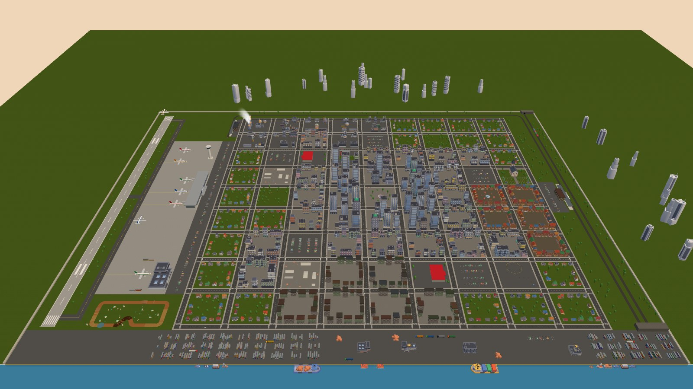

| Supermarkt | Altstadt | Industrie |
|---|---|---|
| 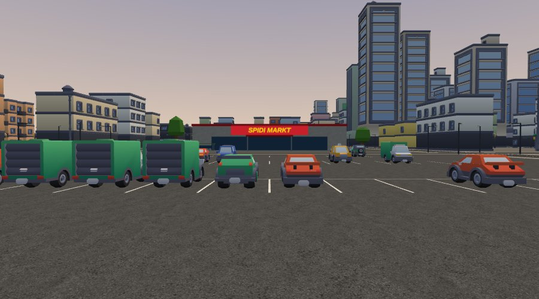 | 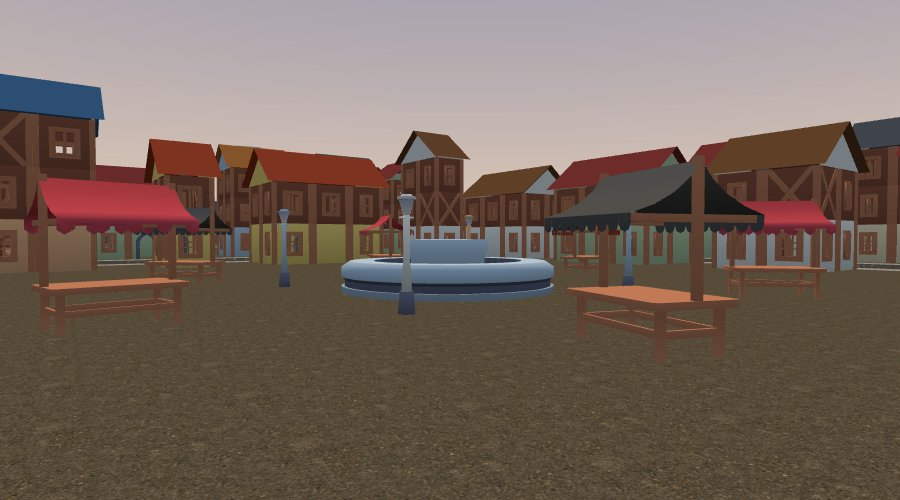 | 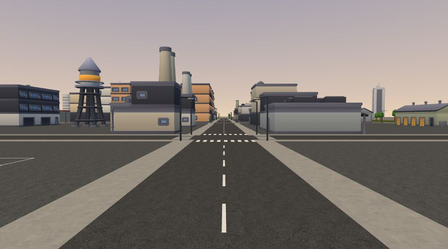 |
| **Skaterpark** | **Hafen** | |
| 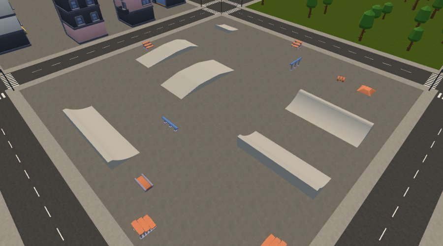 | 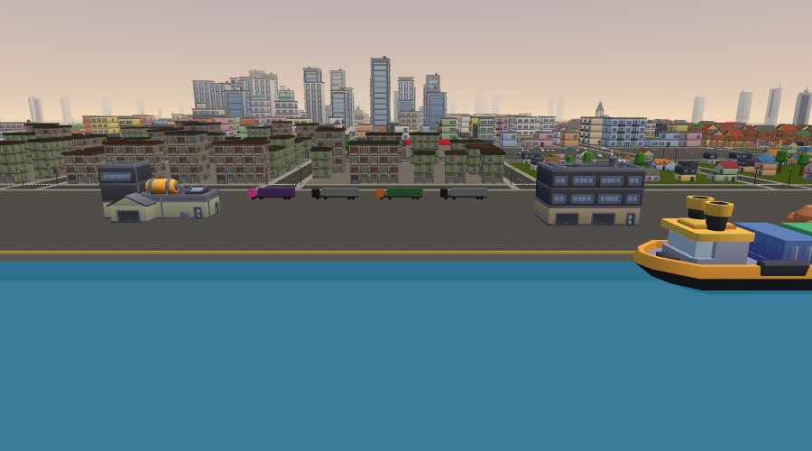 | |

## Netzwerkspiel

1. Den Server starten (Docker oder `npm start`).
2. Alle Mitspieler öffnen `http://<IP-des-Servers>:8090` und wählen **Netzwerkspiel**.
3. Pro Gerät meldet man 1 oder 2 Spieler mit Namen an. Bei 2 Spielern fahren beide im Splitscreen. Ein Fahrzeug wählt man hier noch nicht.
4. Wer zuerst in der Lobby ist, ist **Host**. Er stellt die Rennart ein (**Autorennen**, **Kart-Rennen mit Items** oder **Kart-Battle in der Stadt**), dazu Strecke, Runden und KI-Gegner.
5. In der Lobby wählt jeder sein Fahrzeug, und zwar immer aus der Klasse, die gerade eingestellt ist (Strasse, Offroad, Micro oder Kart). Wechselt der Host die Rennart, wechselt das Fahrzeug automatisch mit.
6. Die Gäste melden sich mit **Bereit ✔**. Der Host sieht „Rennen starten (2/3 bereit)“ und startet, wenn alle da sind. Ist er noch allein oder sind nicht alle bereit, fragt der Knopf einmal nach.
7. Wer während eines Rennens dazukommt, wartet in der Lobby aufs nächste Rennen. Der Host bekommt im Rennen eine Meldung („Cleo wartet in der Lobby“).
8. Der Host kann ein laufendes Rennen jederzeit für alle abbrechen: im Pause-Menü (`Esc`) oder in der Lobby mit **Rennen für alle abbrechen**, dann ein zweiter Klick zur Bestätigung.

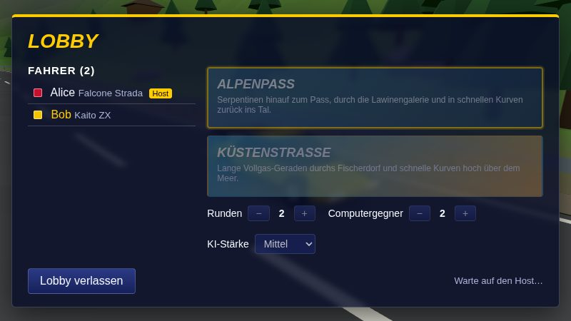

So funktioniert es technisch:
- Jeder Client simuliert seine eigenen Autos und sendet deren Zustand 30-mal pro Sekunde.
- Der Server simuliert die KI-Gegner, entscheidet über Runden, Platzierungen und Zieleinlauf und verteilt den Spielstand an alle.
- Fremde Autos werden mit etwa 110 ms Verzögerung interpoliert, damit sie flüssig fahren.
- Kart-Rennen: Der Server führt die Items aller Karts – Boxen, Würfeln, Projektile, Minen und Treffer – und die KI-Karts samt ihrer Item-Taktik. Die Clients schicken nur „Item benutzen“ und den Drift- und Boost-Zustand ihrer Karts mit; Treffer, Schild und Turbo kommen vom Server zurück. Beim Battle führt der Server zusätzlich die Ballons und erkennt, wer ins Hafenbecken gefallen ist. Eigene Schüsse, Minen, Schild und Turbo erscheinen sofort beim Drücken; der Server bestätigt sie, und sein Schuss übernimmt den angezeigten.

## Rangliste

Jedes beendete Rennen eines menschlichen Fahrers landet in der permanenten Rangliste (Hauptmenü → **Rangliste**):

| Spalte | Inhalt |
|---|---|
| Fahrer, Auto | Name und gewähltes Auto |
| Beste Runde | schnellste Runde – Standardwertung, über alle Rundenzahlen vergleichbar |
| Rennzeit | Gesamtzeit mit Rundenzahl – Wertung je Rundenzahl wählbar |
| Modus, Datum | Einzel, Splitscreen oder Netzwerk; Tag des Rennens |

- Die Wertung gilt pro Strecke. Angezeigt werden die Top 50, gespeichert bis zu 2000 Rennen pro Strecke.
- Für die Übungsfahrt gibt es zwei eigene Listen, **Stadt: Sterne** und **Stadt: Einparken**. Gewertet wird die Gesamtzeit für 5, 10 oder 20 Ziele, dazu wird das schnellste einzelne Ziel angezeigt. Erlaubt sind nur Stadtautos.
- Kart-Rennen haben pro Strecke eigene Listen (`kart:<strecke>`), nur mit Karts; wegen der Boosts liegt die Untergrenze 35 % unter der Höchstgeschwindigkeit.
- Der Server speichert alles in `data/leaderboard.json`. Diese Datei ist **git-ignoriert**. Im Repo liegt nur die leere Vorlage `data/leaderboard.template.json`, mit der ein neuer Server startet.
- Mit Docker wird `./data` in den Container eingebunden. Die Rangliste übersteht Neustarts und Image-Updates und lässt sich einfach sichern.
- Zurücksetzen: `data/leaderboard.json` löschen und den Server neu starten.
- Die API ist `GET /api/leaderboard?track=<id>` (ohne `track`: die Top 50 jeder Wertung) und `POST /api/leaderboard` mit `{ entries: [...] }`.
- Unplausible Zeiten werden abgewiesen: Keine Runde darf schneller sein, als das gewählte Auto die Strecke mit Höchstgeschwindigkeit durchfahren könnte, und das Auto muss zur Streckenklasse passen. Netzwerkrennen trägt nur der Server selbst ein, per HTTP gehen nur Einzel- und Splitscreen-Zeiten. Pro IP sind 10 Einträge pro Minute erlaubt. Einzel- und Splitscreen-Zeiten werden im Browser gemessen und lassen sich deshalb nicht völlig fälschungssicher prüfen.

## Entwicklung

Voraussetzung: **Node.js ≥ 22** (`.nvmrc` liegt bei, also reicht `nvm use`)

```bash
npm install
npm run dev          # Vite-Client auf :5173 (Hot-Reload) + Spielserver auf :8090
npm test             # Strecken-, Physik-, KI-Rennsimulation, Stadt, Server und Rangliste (Vitest)
npm run typecheck    # TypeScript für shared, client und server
npm run build        # Produktionsbuild: client/dist + server/dist/index.cjs
npm start            # Produktionsserver auf :8090 (liefert auch den Client aus)
npm run assets       # CC0-Assets neu herunterladen (siehe unten)
```

**Neue Strecke anlegen:**
1. In `shared/src/tracks.ts` eine Liste von Kontrollpunkten `[x, z, höhe, breite?]` hinzufügen. Dazu ein Theme wählen (`alpine`, `coast`, `city`, `speedway`, `desert`, `forest`, `table`, `airport`). Mit `modes: ['race']` bzw. `modes: ['kart']` erscheint eine Strecke nur im Autorennen bzw. nur im Kart-Rennen (ohne Angabe: alle im Autorennen, alle ausser Micro im Kart-Rennen). Optional kommen dazu: Galerien/Unterführungen, eine Kurvenüberhöhung (`banking`) für Micro `class: 'micro'` (mit `camera: 'topdown'`) und für Offroad `class: 'offroad'`, Untergründe (`surface`, `surfaces`) sowie Sprünge (`jumps`).
2. `npm test` ausführen. Der Test prüft, dass sich die Strecke nicht selbst schneidet und dass KI-Fahrer sie komplett befahren können.
3. Mit `http://localhost:5173/?view=<strecken-id>@<meter>` fährt die Kamera langsam ab der gewünschten Stelle über die Strecke, das ist praktisch zum Begutachten der Szenerie.

## Grafik-Assets

Alle Modelle und Texturen stehen unter **CC0 (Public Domain)** und liegen in [`client/public/cc0/`](client/public/cc0/CREDITS.md).

| Quelle | Paket | Verwendung |
|---|---|---|
| [Kenney](https://kenney.nl/assets/car-kit) | Car Kit | 14 Autos (`sedan-sports`, `race-future`, `race`, `hatchback-sports`, `suv`, `suv-luxury`, `truck`, `sedan`, `taxi`, `police`, `firetruck`), dazu `van` und `delivery` für den Stadtverkehr |
| [Kenney](https://kenney.nl/assets/nature-kit) | Nature Kit | Bäume, Felsen, Büsche, Kakteen, Klippen, Baumstämme, Pilze, Zelt, Lagerfeuer |
| [Kenney](https://kenney.nl/assets/city-kit-suburban) | City Kit (Suburban) | Häuser im Dorf, Chalets |
| [Kenney](https://kenney.nl/assets/city-kit-commercial) | City Kit (Commercial) | Geschäftshäuser und Hochhäuser in Downtown und der Übungsstadt |
| [Kenney](https://kenney.nl/assets/city-kit-industrial) | City Kit (Industrial) | Hallen, Fabriken, Wasserturm, Schornsteine, Container, Windrad (Übungsstadt) |
| [Kenney](https://kenney.nl/assets/fantasy-town-kit) | Fantasy Town Kit | Fachwerkwände, Brunnen, Marktstände, Laternen der Altstadt; Steinwände und Rundbogenfenster der Kirche |
| [Kenney](https://kenney.nl/assets/retro-urban-kit) | Retro Urban Kit | Fassaden, Markisen und Bänke des Backstein-Viertels |
| [Kenney](https://kenney.nl/assets/food-kit) | Food Kit | Frühstückstisch: Müslischale, Tassen, Teller, Croissant, Besteck, Obst |
| [Kenney](https://kenney.nl/assets/mini-skate) | Mini Skate | Rails, Grind-Boxen, Bänke und Skater im Skaterpark |
| [Kenney](https://kenney.nl/assets/watercraft-kit) | Watercraft Kit | Frachter, Schlepper, Boote, Container und Bojen im Hafen |
| [Kenney](https://kenney.nl/assets/train-kit) | Train Kit | S-Bahn, Lok und Güterwagen |
| [Kenney](https://kenney.nl/assets/graveyard-kit) | Graveyard Kit | Grabsteine, Grüfte, Eisenzaun, Laternen und Kiefern des Friedhofs |
| [Kenney](https://kenney.nl/assets/blaster-kit) | Blaster Kit | Blaster auf den Karts, Schaumstoffpfeile, Granaten als Minen |
| [Kenney](https://kenney.nl/assets/mini-characters) | Mini Characters | Fussgänger in der Übungsstadt (Lauf- und Sitz-Animationen) |
| [Kenney](https://kenney.nl/assets/cube-pets) | Cube Pets | Hunde der Spaziergänger |
| [ambientCG](https://ambientcg.com) | Asphalt031, Grass004, Rock064, Snow010A, Ground080, Gravel043, Concrete034 | Strasse, Gelände, Bankett, Mauern |
| [ambientCG](https://ambientcg.com) | Ground106, Ground037, Ground071, Ground093C, Rock029, Ground097 | Offroad: Waldweg, Waldboden, Schlamm, Dünen, roter Fels, Wüstenpiste |
| [ambientCG](https://ambientcg.com) | Wood049 | Micro: Holztisch |

`npm run assets` ([scripts/fetch-assets.mjs](scripts/fetch-assets.mjs)) lädt die Original-Pakete herunter und kopiert nur die benötigten Dateien nach `client/public/cc0/`. Dabei entsteht auch die Datei `CREDITS.md` neu.

Fehlen die Assets oder lassen sie sich nicht laden, startet das Spiel automatisch mit der prozeduralen Grafik aus Version 0.1.0.

## Architektur

```
shared/   Fahrphysik, Strecken (Catmull-Rom-Spline), Autos, Rennlogik, KI, Netzwerkprotokoll,
          Übungsstadt (town.ts), Stadtverkehr (traffic.ts), Aufgaben (townTasks.ts),
          Flughafen-Layout für beide Flughafenstrecken (airport.ts), Modus-Zuordnung (tracks.ts: RACE_TRACKS, KART_TRACKS)
client/   Vite + Three.js
  src/render/   Asset-Loader, Gelände (Splat-Shader), Strasse, Szenerie, Frühstückstisch/Küche, Automodelle, Kameras
  src/ui/       app.ts (Ablauf, Pause) · menus · town · results (Ergebnis, Rangliste) · lobby · widgets · prefs
                html.ts: Templates, die jede Einsetzung automatisch escapen
  src/game.ts   Spielschleife (feste 60 Hz), Splitscreen, Interpolation, Netz-Sync
  src/townGame.ts, townHud.ts, render/townWorld.ts   Übungsfahrt in der Stadt
  src/render/buildingKit.ts   Gebäude der Übungsstadt: Farbvarianten per Shader, Häuser aus Bauteilen, Supermarkt
  src/render/airportScenery.ts   Flughafen-Kulisse (drei gekreuzte Pisten, Docks, Tower, Hangars, Fracht, Rollwegbrücke, prozedurale Jets, startende Flugzeuge)
  src/render/townAirport.ts      Flugplatz der Übungsstadt (Piste, Rollweg, Vorfeld, Terminal, Fracht, Tower, Flugzeuge)
scripts/footprints.mjs      misst die Grundflächen der Stadtgebäude (Kollision ohne Vordächer) → shared/src/townFootprints.ts
server/   Node + ws: app.ts (HTTP, Statik, API, WebSocket-Upgrade), room.ts (Lobby, Rennstatus, KI), leaderboard.ts
.github/  CI: Typecheck, Tests und Build bei jedem Push
scripts/  Asset-Download
```

- **Physik**: ein eigenes, deterministisches Arcade-Modell (Einspurmodell mit Grip-Limit). Derselbe Code läuft im Browser und auf dem Server. Der Fahrkern `driveCar` ist für Strecken und Stadt gleich, nur der Rand unterscheidet sich: Leitplanken entlang des Splines bzw. Gebäude, Bäume und Pylonen in der Stadt.
- **Strecken**: Die Strasse ist ein Spline mit einem Kontrollpunkt etwa alle 2 m. Strassenbelag, Bankette, Leitplanken und Gelände werden daraus erzeugt, die Szenerie wird mit festem Zufalls-Seed verteilt.
- **Rendering**: Bäume, Felsen und Häuser sind InstancedMeshes, so bleibt die Zahl der Draw Calls auch mit tausenden Objekten klein. Der Splitscreen nutzt einen einzigen Renderer mit zwei Scissor-Viewports.

## Versionierung

Das Projekt folgt [Semantic Versioning](https://semver.org/lang/de/). Die aktuelle Version ist **1.4.1**. Änderungen stehen im [CHANGELOG](CHANGELOG.md), Releases sind als Git-Tags `vX.Y.Z` markiert. Die Version steht auch unten rechts im Hauptmenü.

## Lizenz und Credits

- **Code**: [MIT](LICENSE) – created by Adrian S. and Anthropic Claude
- **Modelle und Texturen**: CC0 von [Kenney](https://kenney.nl) und [ambientCG](https://ambientcg.com). Herzlichen Dank! Details stehen in [CREDITS.md](client/public/cc0/CREDITS.md).
- *Need for Speed* ist eine Marke von Electronic Arts. Spidi Race ist ein unabhängiges Fan-Projekt ohne Verbindung zu EA.
